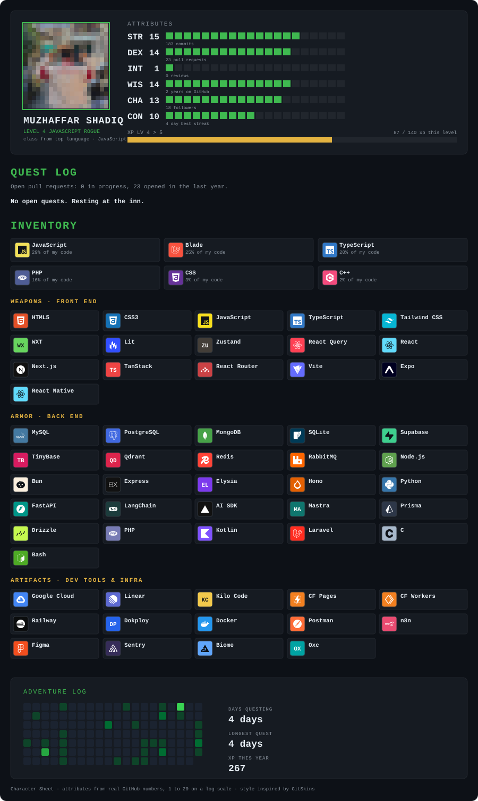

<!-- HEADER BANNER / TYPING SVG -->
<h1 align="center">
  
</h1>

  <b>Software Engineering & Systems Development</b>

  📍 Indonesia &nbsp;|&nbsp; 🌐 <a href="https://github.com/mrshaadiq">github.com/mrshaadiq</a>

---

### 💫 About Me

###

  

---

### 🚀 Aktivitas Terbaru
<!-- recent_activity starts -->
_Belum ada data._
<!-- recent_activity ends -->

---

### 🔗 Connect with Me

  
  
  

